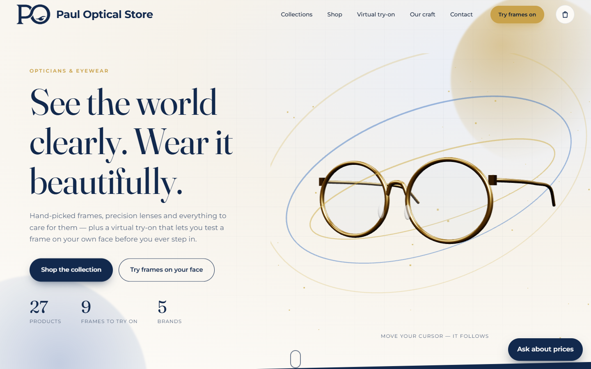
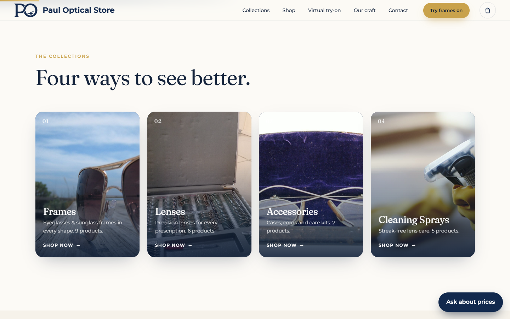
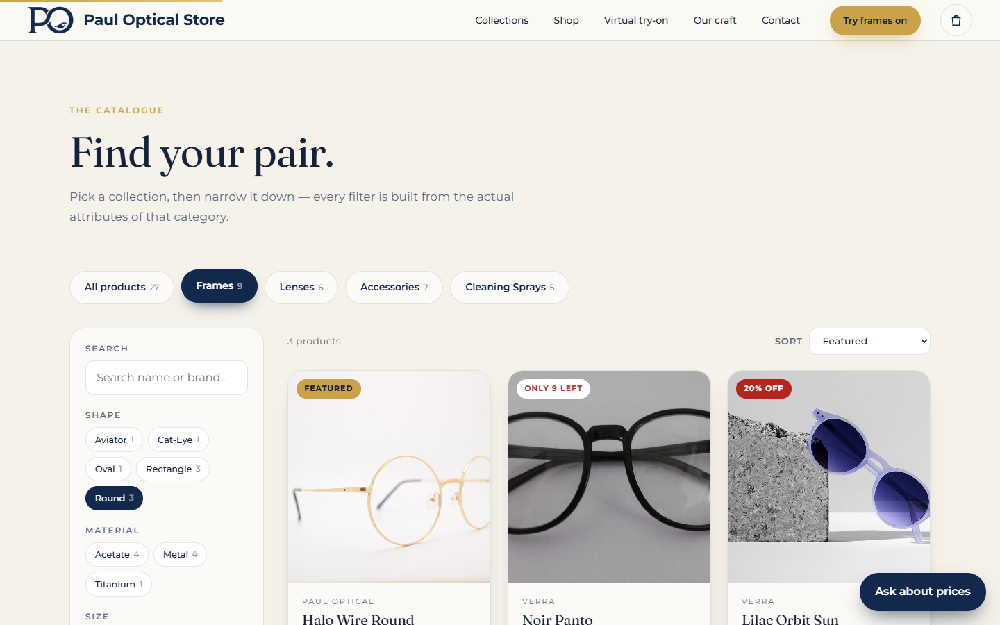
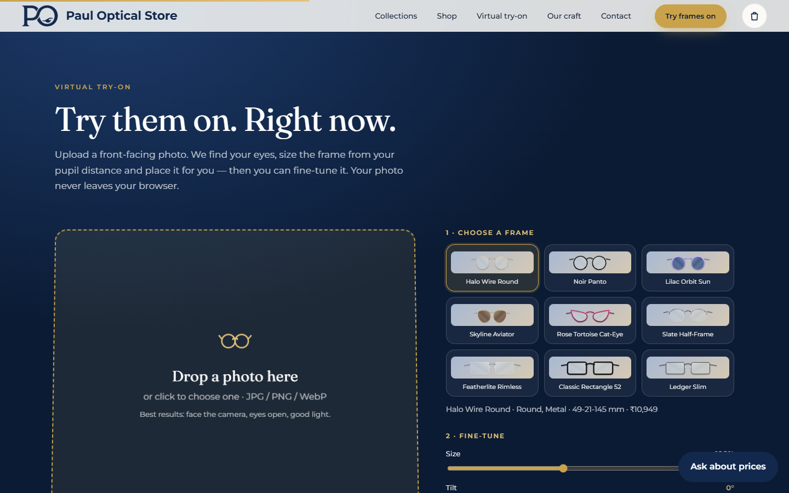
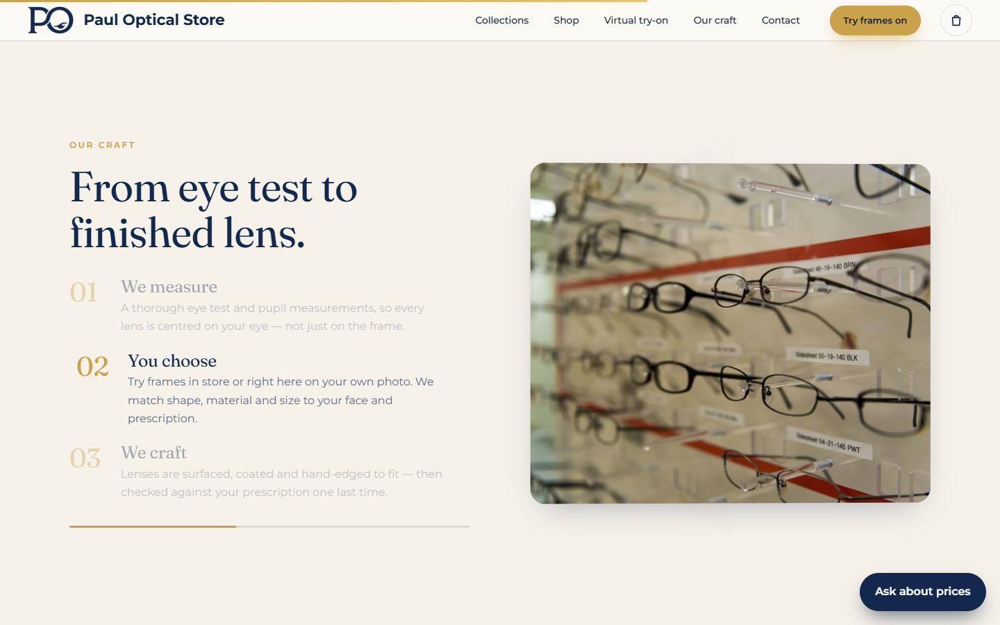
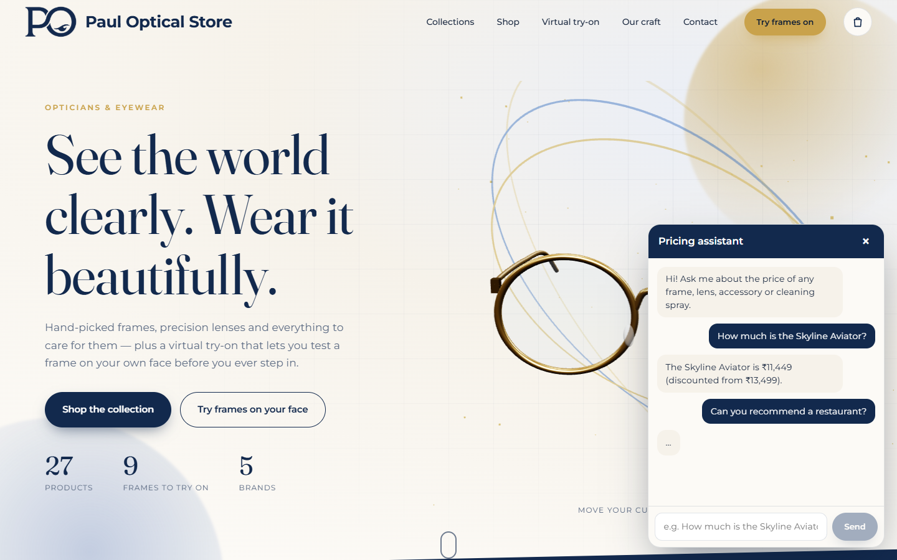
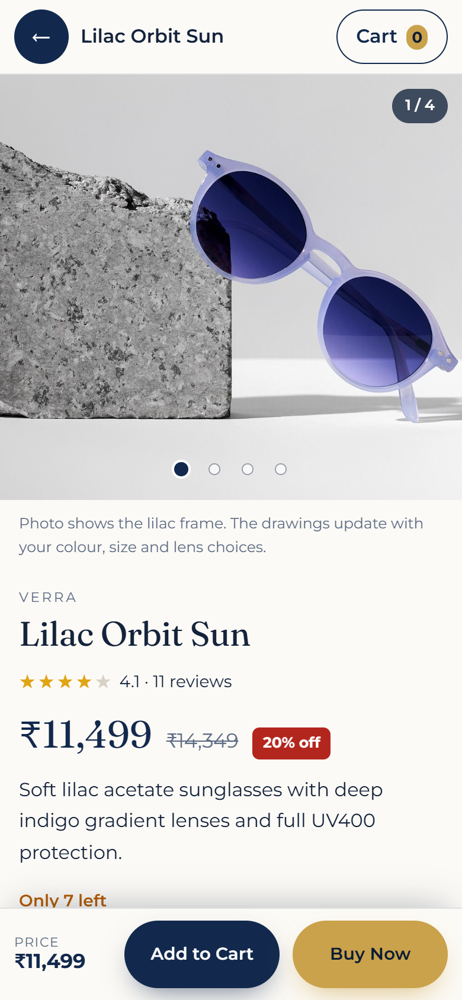
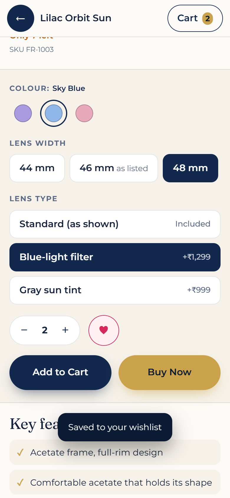
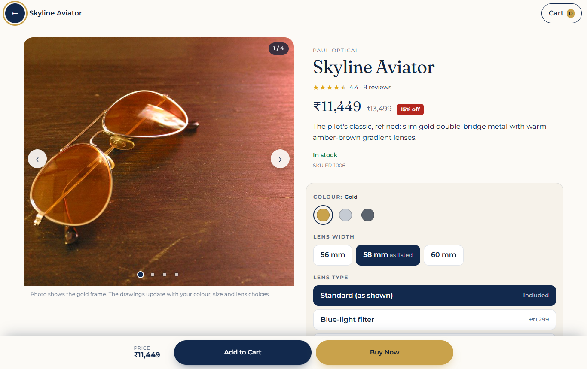
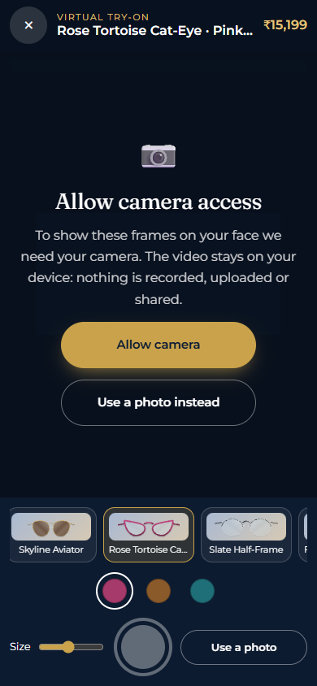

> Developer reference. For the project overview and quick start, see the [main README](../README.md).

# Technical notes: Paul Optical Store website

A complete, runnable store site: a **Flask + SQLAlchemy (SQLite)** back end and a plain HTML/CSS/JS front end
with 3D and scroll-driven animation, category filters, and a **virtual try-on** that fits frames to an uploaded face.

> **Demo store.** Brands, prices, stock and the "Our craft" copy are sample data and there is no checkout. The point is the engineering: a real back end, a data-driven catalogue, in-browser face fitting, and a document-grounded AI assistant.

| | |
|---|---|
|  |  |
|  |  |
|  |  |

(The try-on shot shows the empty state; the app never ships anyone's photo. Mobile layout: `docs/7-mobile.png`.)

## Run it

Requires Python 3.10+ and nothing else (no database server, no environment variables, no Node/npm — all JS libraries are already included).

```bash
pip install -r requirements.txt
python app.py
```

Open **http://127.0.0.1:5000**.

On first start the app creates `paul_optical.db` next to `app.py` and seeds it with 27 sample products
(9 frames, 6 lenses, 7 accessories, 5 cleaning sprays). To reset the data, stop the server, delete `paul_optical.db`, start again.

Run the checks (catalogue, filters, try-on overlays, reviews, security headers, database first-run and upgrade, and that every image loads / is unique / is credited):

```bash
python -m unittest discover -s tests -v
```

Optional browser checks for interactions unit tests can't see (Escape handling, keyboard focus, cart vs stock, the phone filter sheet, the 3D hero). Needs `pip install playwright` and the server running:

```bash
python tests/browser_checks.py
```

## What's in the box

| | |
|---|---|
| `app.py` | Flask app + JSON API (`/api/categories`, `/api/facets`, `/api/products`, `/api/frames/<id>/overlay.svg`) |
| `models.py` | SQLAlchemy models. A base `products` table plus one table per category whose **NOT NULL columns are that category's required attributes** |
| `seed.py` | Sample data. Attributes were written to match what each product photo actually shows |
| `frames_svg.py` | Generates each frame's transparent try-on SVG from its database row, drawn in real millimetres |
| `static/` | The site: `index.html`, `css/`, `js/` (ES modules), `img/` (all photos), `vendor/` (GSAP, three.js, MediaPipe, fonts) |
| `tests/test_site.py` | Automated checks, see above |
| `tools/` | Dev-time helpers used to source the photos (not needed to run the site) |

### Categories and their required fields

| Category | Required attributes (filterable ones in bold) |
|---|---|
| Frames | **shape, material, size, colour, rim type, gender, lens tint**, colour hex, lens width / bridge / temple (mm) |
| Lenses | **lens type, index, material, coating**, UV protection |
| Accessories | **type, material, colour, fits** |
| Cleaning sprays | **formula, scent, safe-for, volume (ml)**, includes cloth |

Filters are built from the data itself (`/api/facets`), so adding a product with a new material or scent adds that filter option automatically.
To add a product, append a row in `seed.py` (or insert via SQLAlchemy); to add an attribute, add a column in `models.py` and list it in `CATEGORIES`.
API filter example: `/api/products?category=frames&shape=Round&shape=Aviator&material=Metal&max_price=150&sort=price_asc`
(repeat a parameter to OR its values; different parameters AND together).

## Customer messages

The **Contact** section on the page takes a name, phone number and message. On *Send message* it is saved to the `messages` table in `paul_optical.db` (SQLite, created automatically).

To read them, open **http://127.0.0.1:5000/admin**. The browser asks for a login: any username, and the password from `admin_password.txt` (or your `ADMIN_PASSWORD` variable)
(it is generated on first run and kept in `admin_password.txt`; set an `ADMIN_PASSWORD` environment variable to use your own instead). Messages are shown newest first and are HTML-escaped.
Anyone who can open the site can *send* a message, but only someone with the password can read them. Use HTTPS if you host it publicly.

## Pricing chatbot

The **Ask about prices** button (bottom right) opens a chat that answers **only** from `pricing.md`, using Google AI Studio (Gemini). Anything else gets one fixed refusal pointing to the Contact form.

1. Copy `.env.example` to `.env` and paste your key from https://aistudio.google.com/apikey as `GEMINI_API_KEY`. `.env` is git-ignored.
2. Restart `python app.py`. Optional: `GEMINI_MODEL` in `.env` (default `gemini-3.1-flash-lite`).

How it works (`chatbot.py`, standard library only, no RAG): `pricing.md` is read at startup and placed in the **system prompt** with strict rules and the exact refusal sentence;
it is repeated around each customer question. Errors (no key, bad key/model, Google busy, network down) return a clear message instead of crashing.

`pricing.md` is generated from the product database, so it can't drift from the shop. After changing products run `python tools/make_pricing.py` and restart.

## Product detail page, cart and live try-on

Tap a product's photo, name or **View details** in the shop (or open `/product/<id>`, a shareable link; the browser Back button closes it). Sections, in this order:

1. **Image carousel**: swipe (or arrows / keys / dots) through the product photo and, for frames, generated drawings of the *front*, *side* and a *measurements* diagram. They redraw when you change colour, lens width or lens type. Counter + dots show your place. Products with one photo show it without carousel controls.
2. **Core info**: name, rating summary, current price with the original price struck through and `% off` when discounted, description, stock.
3. **Purchase actions**: colour, lens width (±2 mm) and lens type (standard / blue-light +₹1,299 / gray tint +₹999) for frames, quantity, wishlist heart, **Add to Cart** and **Buy Now**. A sticky bottom bar keeps both reachable once the in-page buttons scroll away.
4. **Key features**: short bullets built only from the product's real attributes.
5. **Virtual try-on**: the **Try On** button opens the live camera (below).
6. **Customer reviews**: average and count, star histogram (tap a bar to filter), sort (recent / highest / lowest), filter by rating, **Load more**, an empty state, and a form to post a review.

**Cart and checkout.** The cart lives in the browser (`localStorage`) and opens from the header bag. There is no payment system: *Place order request* sends the order (items, options, total, name, phone) into the same inbox as contact messages, visible at `/admin` as `ORDER REQUEST`, and the shop calls to confirm. Prices are re-checked by staff, never trusted from the browser.

**Live try-on (camera).** `static/js/live.js` + `facefit.js`. Tapping **Try On** shows a short explainer first; the browser's own camera prompt only appears after you tap *Allow camera*.
Every video frame is drawn to a canvas (mirrored like a selfie camera); MediaPipe finds your pupils; the frame is scaled from pupil distance (63 mm average), rotated with head tilt, narrowed a little when you turn your head, and smoothed so it stays locked on as you move. Switch frames and colours while live, adjust size, and press the shutter to save a PNG.
If permission is blocked the screen explains how to unblock it and offers *Use a photo instead* (same fitting code); the same fallback appears when there is no camera, or when the page isn't on HTTPS/localhost (browsers only allow cameras on secure pages). The camera stops when you close the view or switch tabs. Nothing is recorded or uploaded.

**Notes.** Product photos are single photographs, so extra gallery slides for frames are drawings made from the product data rather than additional photos, and the photo shows the listed colour only. Sample reviews are tagged *Sample review*; reviews posted through the form are real and appear immediately (rate-limited, no moderation). Five products have no reviews on purpose, to show the empty state. Discounts and colourways are sample data in `seed.py`.

## The virtual try-on (page section)

Code: `static/js/tryon.js` (the approach is also documented in its header comment).

1. The user's photo is drawn to a canvas in the browser. **It is never uploaded.**
2. **MediaPipe Face Landmarker** (bundled in `static/vendor/mediapipe`, runs locally via WebAssembly) finds 478 face landmarks; the two iris centres are the pupils.
3. Each frame's overlay is an SVG the back end draws in **real millimetres** with the point between the pupils at its exact centre. The browser sets
   `pixels-per-mm = pupil distance in photo ÷ 63 mm` (average adult), so a *Small* frame genuinely looks smaller than a *Large* one, and positions and rotates it using the pupil midpoint and the angle of the line between the pupils.
4. **Manual mode is always available:** drag the frame, scroll over it (or the Size slider) to resize, the Tilt slider to rotate, arrow keys to nudge,
   *Auto-fit* to reset. If the model can't load or no face is found, the frame is centred and the user places it by hand.
5. *Save image* downloads the composite as a PNG.

Limits: it is a 2-D overlay, so strongly turned heads (yaw) can't be matched, and front-facing photos with open eyes work best.
Frames are drawn programmatically (front view) rather than photographed, so they're an accurate shape/colour/size preview, not a photoreal render.

## Images

All 34 photos are from **Wikimedia Commons** under open licences (CC0, public domain, CC BY, CC BY-SA), downloaded into `static/img/<category>/` so there are no hot-linked images to break.
Authors, licences and source links are in [CREDITS.md](../CREDITS.md) and in the site footer (*Image credits*). Each image is used exactly once on the site
(enforced by `tests/test_site.py`); the try-on picker uses the generated frame drawings, not the product photos.
`tools/find_images.py` and `tools/fetch_images.py` are the scripts that found and downloaded them. The logo is `static/img/site/logo.png` (your artwork, cropped, with the white background made transparent).

## Things you'll probably want to change

- **Currency / prices:** the shop sells in Indian rupees (₹). `seed.py` holds the prices written in US$ and converts them at `USD_TO_INR = 85`; the display format is one line in `static/js/api.js`.
  To change the rate: edit `USD_TO_INR`, delete `paul_optical.db`, restart (note this also clears saved customer messages), then run `python tools/make_pricing.py` and restart again.
- **Store details, product copy, prices, stock:** all sample content. Edit `seed.py` (then reset the DB) and the text in `static/index.html`.
  The site has no address, phone, or checkout, since none were specified.
## Deploying

`python app.py` is Flask's development server: fine locally, not for the public. Use the included production setup:

```bash
waitress-serve --host=0.0.0.0 --port=8080 app:app      # any server; waitress is in requirements.txt
```

- `Procfile` (Render / Railway / Heroku-style hosts) and `Dockerfile` (any container host) are included. I verified the app under waitress locally; I have **not** deployed the Docker image or Procfile to a live host.
- Set `GEMINI_API_KEY` and `ADMIN_PASSWORD` as **environment variables on the host**; do not upload `.env`.
- The SQLite file lives next to `app.py`. Many hosts have an ephemeral disk, so mount a persistent volume or customer messages will be lost on redeploy.
- Serve over **HTTPS** (the admin page uses Basic auth). Rate limits are in-memory per process and keyed on the client IP; behind a reverse proxy configure `werkzeug.middleware.proxy_fix.ProxyFix` so the real IP is used.

## Security notes

- Secrets live only in `.env` / environment variables. `.env`, `admin_password.txt` and `paul_optical.db` are git- and docker-ignored. **Never commit them, and rotate any key that has been pasted into a chat or shared.**
- The admin password is auto-generated (saved in `admin_password.txt`) unless `ADMIN_PASSWORD` is set; the server warns if it is under 12 characters. **Repeated wrong logins lock that IP out of `/admin` for 5 minutes** (8 attempts), and the lock applies before the password is compared.
- The message form and the chatbot are rate-limited per IP (10 and 20 per minute), the form has a honeypot field, request bodies are capped at 64 KB, all customer text is HTML-escaped on the admin page, and every database query is parameterised through SQLAlchemy.
- **Browser protections:** a strict Content-Security-Policy (only the site's own files may run; no `unsafe-eval`; nothing loads from other origins), `X-Frame-Options: DENY`, `nosniff`, a locked-down Permissions-Policy, and HSTS when served over HTTPS. The whole site (3D hero, face model, chat, forms) is tested under this policy.
- Dependencies were checked with `pip-audit` (no known vulnerabilities at the time of writing).
- **Before you publish:** run `python tools/check_secrets.py`. It scans everything that would be pushed for API keys, passwords and private files.
- The chatbot can only see `pricing.md` (prices and specs), never customer messages or the database.

## Known limits (honest list)

- The try-on is a 2-D overlay: strongly turned heads won't fit, and frames are generated drawings, not product photos.
- No cart, checkout or accounts. Photos are mixed-quality open-licence images, not a studio shoot.
- Rate limiting and sessions are single-process (see Deploying).

## Browser support

Current Chrome, Edge, Firefox and Safari. The 3D hero needs WebGL (the page still works without it) and animations are reduced or disabled for visitors who set *prefers-reduced-motion*.


## More screenshots

| | |
|---|---|
|  |  |
|  |  |

